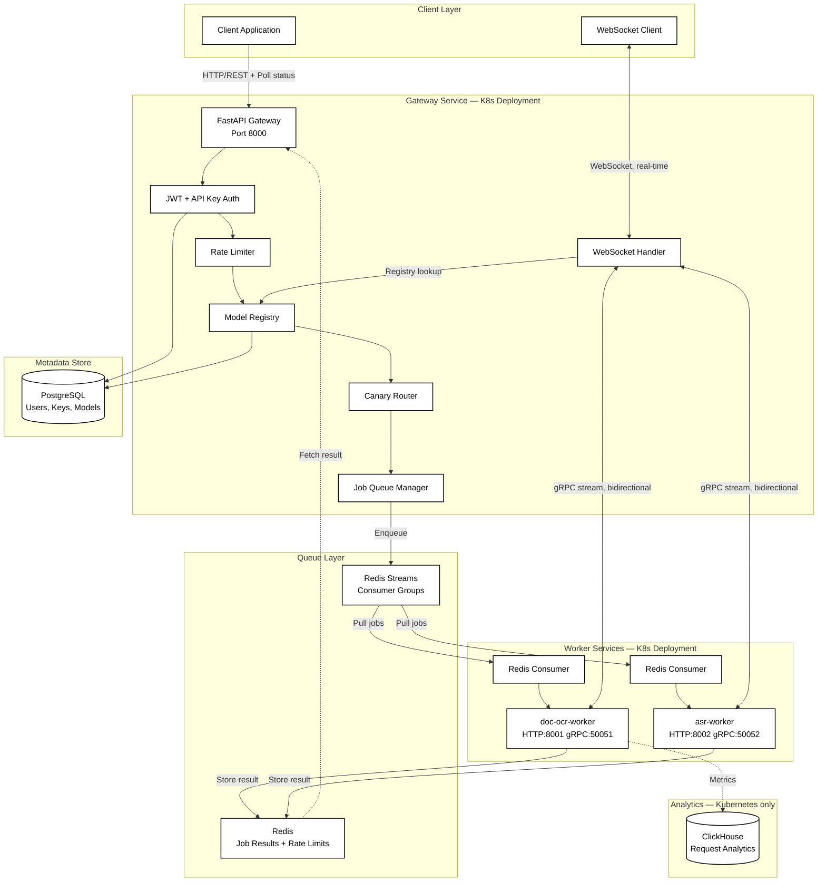

# ModelMesh — Multi-Model Inference Gateway

A horizontally scalable ML serving platform demonstrating registry-driven architecture, async job queues, real-time streaming, and Kubernetes orchestration.

**Status**: Development implementation; known gaps and current behavior are documented below.

📖 **[Setup Guide](SETUP.md)** | ▶️ **[Run and stop ModelMesh](RUNNING.md)** | 📁 **[Documentation](docs/)**

---

## What is ModelMesh?

ModelMesh is an inference gateway built to solve a core problem in ML serving: **how do you add, version, and route between multiple models without constantly redeploying your gateway code?**

Most inference servers hardcode model names and endpoints. Adding a new model = code change + deployment. Switching protocols (HTTP → gRPC) = refactor. Canary rollouts = complex Kubernetes replica manipulation.

ModelMesh stores model metadata in a PostgreSQL registry and uses it to assign asynchronous jobs to workers. The WebSocket path reads protocol and endpoint from the registry, but still contains model-name-specific branches; REST jobs do not use the registry protocol, and WebSocket inference does not use canary routing. Removing those remaining model-specific branches is planned for Phase 8.

This project provides a working inference baseline across five phases. Phase 5 observability is partial; Prometheus and Grafana are not implemented.

---

## Why This Architecture Matters

### The Registry Pattern

Traditional approach:

```python
if model_name == "doc-ocr":
    return http.post("http://ocr-worker:8001/infer", data)
elif model_name == "asr":
    return http.post("http://asr-worker:8002/infer", data)
```

Every new model requires code changes. Switching protocols requires refactoring. Versioning requires complex routing logic.

ModelMesh approach (asynchronous REST job assignment):

```python
model = await registry.get_model(db, model_name)  # DB lookup
job = {"model_name": model.name, "worker_name": model.worker_name}
```

Adding a model:

```bash
POST /v1/models {"name": "new-model", "protocol": "grpc", "endpoint": "..."}
```

This registers model metadata; a new inference type may still require code changes. Direct WebSocket inference currently has model-specific branches (Phase 8).

Switching protocols for WebSocket inference (the REST job path ignores `protocol`):

```sql
UPDATE models SET protocol = 'grpc', endpoint = 'worker:50051' WHERE name = 'doc-ocr';
```

For WebSocket inference, this changes HTTP/gRPC without a code change or deployment.

---

## System Architecture



---

## Key Design Decisions

### 1. Registry-Driven Routing

**Problem**: Hardcoded model names force redeployments for every model addition.

**Solution**: The `models` table stores name, version, worker_name, protocol, and endpoint. The asynchronous REST path resolves the worker from registry metadata; direct WebSocket inference still has model-name-specific branches (Phase 8).

**Payoff**:

- Phase 3: WebSocket protocol selection (HTTP or gRPC) reads registry data; REST jobs do not read the protocol field
- Phase 5: REST canary rollout uses a new version row and `canary_percent`; WebSocket inference does not use canary routing

### 2. Async Queue Architecture

**Problem**: Synchronous inference blocks gateway capacity. Slow requests stall everything.

**Solution**: Gateway enqueues jobs to Redis Streams, returns job_id immediately. Workers pull from queue at their own pace.

**Payoff**:

- Gateway never blocks
- Workers scale independently (3 replicas = 3x throughput)
- Retries + DLQ for failed jobs

**Trade-off**: Clients poll `/v1/jobs/{id}` instead of instant response (Phase 3 adds WebSockets to fix this)

### 3. Multi-Service Containers

**Problem**: Splitting HTTP + gRPC + Redis consumer into separate processes may load model resources more than once.

**Solution**: A worker container starts the HTTP server, gRPC server, and Redis consumer as separate processes. The processes do not share in-memory model instances.

**Trade-off**: Each process can load its own model instance; running services in one container does not mean model weights are loaded only once. Compose measurements showed the ASR container at 819.6 MiB and the doc-ocr container at 1.264 GiB at an idle/no-streaming checkpoint; Kubernetes measurements require a running cluster.

### 4. Protocol Selection

The WebSocket path reads `protocol` and `endpoint` from the registry, then calls `route_request`. That function still contains model-name-specific branches; generic model dispatch is planned for Phase 8. The REST job path queues work and does not read the `protocol` field.

---

## What Was Built

### Phase 1: Core Gateway ([docs](docs/Phase1-Core-Gateway.md))

- Dynamic model registry (PostgreSQL)
- JWT auth + API key management
- Redis rate limiting (fixed window)
- Two workers: EasyOCR (doc-ocr) + Whisper (asr)

### Phase 2: Async Job Queue ([docs](docs/Phase2-Async-Job-Queue.md))

- Redis Streams job queue with consumer groups
- Dormant Kafka alternative code (not wired into the application or Compose)
- Exponential backoff retry logic (2s, 4s, 8s)
- Dead-letter queue for failed jobs
- Consumer lag monitoring (XLEN, XPENDING)
- Horizontal worker scaling

### Phase 3: Streaming + gRPC ([docs](docs/Phase3-Streaming-gRPC-WebSockets.md))

- WebSocket endpoint for real-time streaming
- gRPC with Protocol Buffers for internal communication
- Bidirectional streaming RPC (PredictStream)
- WebSocket protocol selection from registry data (HTTP ↔ gRPC); REST jobs do not read `protocol`
- Multi-service containers (HTTP + gRPC + Redis consumer)

### Phase 4: Kubernetes ([docs](docs/Phase4-Kubernetes-Deployment.md))

- Namespace isolation (`modelmesh`)
- StatefulSet for Postgres with PersistentVolume
- Deployments for Gateway, Workers, Redis
- ConfigMaps for Postgres init SQL
- Secrets for JWT + DB passwords
- Resource requests/limits + health probes
- Tested on minikube (2 CPU / 4GB RAM)

### Phase 5: Observability + Canary ([docs](docs/Phase5-Observability-Canary.md))

**Implemented**:

- Best-effort ClickHouse metric logging from the doc-ocr worker in Kubernetes
- Canary routing logic (`canary_percent` field in registry)
- Version pinning support (`?version=v1` bypasses canary)

**Not Implemented / Not Available**:

- Prometheus instrumentation and `/metrics` endpoints
- Prometheus and Grafana deployment
- ClickHouse service in Docker Compose; Compose workers log a warning when metric writes fail
- ASR worker metric logging

---

## Tech Stack

| Component         | Technology                          | Purpose                                |
| ----------------- | ----------------------------------- | -------------------------------------- |
| **Gateway**       | FastAPI (Python 3.11+)              | HTTP/WebSocket API server              |
| **Workers**       | EasyOCR, Whisper                    | Pretrained PyTorch models              |
| **Queue**         | Redis Streams; dormant Kafka code   | Async job distribution                 |
| **Metadata**      | PostgreSQL                          | Users, keys, models (the requests table is not currently written) |
| **Analytics**     | ClickHouse (Kubernetes only)        | Best-effort doc-ocr worker metrics      |
| **Protocols**     | HTTP/REST, WebSocket, gRPC/Protobuf | Client and internal communication      |
| **Orchestration** | Docker Compose, Kubernetes          | Dev and local deployment               |

---

## What This Demonstrates

**Architecture Patterns**:

- Registry-driven worker assignment; direct WebSocket inference still has model-specific branches
- Async queue decoupling (gateway never blocks)
- WebSocket protocol selection from registry data (HTTP/gRPC)
- Multi-process worker containers (HTTP + gRPC + Redis consumer)
- Canary deployments without K8s complexity

**Engineering Skills**:

- API design (FastAPI, REST, WebSocket, gRPC)
- Queue systems (Redis Streams, consumer groups; dormant Kafka code)
- Database design (transactional + analytical workloads)
- Kubernetes manifests (StatefulSets, PVCs, Services)
- Observability (best-effort doc-ocr ClickHouse metrics)

**System Thinking**:

- Trade-offs documented (async vs sync, HTTP vs gRPC, Redis Streams vs dormant Kafka code)
- Failure modes handled (retry logic, DLQ, idempotency)
- Honest scope (production gaps clearly stated)

---

## Limitations & Scope

**What this is:**

- Development/learning project demonstrating ML serving architecture
- Tested on Docker Compose and local minikube only
- Built to showcase registry-driven design patterns

**What this is NOT:**

- Production-ready (secrets committed to git, no TLS, no external monitoring)
- Tested at scale (minikube: 2 CPU / 4GB RAM)
- Multi-tenant ready (basic auth, no isolation)

**Known gaps:**

- Kubernetes secrets committed to repo (NOT production-safe)
- Prometheus instrumentation and Prometheus/Grafana deployment are not implemented
- ClickHouse is not included in Docker Compose; Compose metric writes produce warnings
- No Ingress controller or TLS
- No CI/CD pipeline
- Tested with small payloads only

---

## Project Structure

```
modelmesh/
├── gateway/                 # FastAPI gateway + registry
│   ├── main.py
│   ├── registry.py
│   ├── job_queue.py
│   ├── grpc_client.py
│   └── metrics.py
├── workers/                 # Model workers
│   ├── doc_ocr/            # EasyOCR (HTTP + gRPC + consumer)
│   └── asr/                # Whisper (HTTP + gRPC + consumer)
├── k8s/                    # Kubernetes manifests
│   ├── gateway/
│   ├── workers/
│   ├── postgres/
│   ├── redis/
│   └── clickhouse/
├── docs/                   # Phase documentation
│   ├── Phase1-Core-Gateway.md
│   ├── Phase2-Async-Job-Queue.md
│   ├── Phase3-Streaming-gRPC-WebSockets.md
│   ├── Phase4-Kubernetes-Deployment.md
│   └── Phase5-Observability-Canary.md
├── inference.proto         # gRPC contract
├── docker-compose.yml
├── SETUP.md               # Setup instructions
└── README.md              # This file
```

---

## Quick Start

```bash
# Docker Compose
# See RUNNING.md for start, rebuild, stop, and resume commands.

# Kubernetes (minikube)
minikube start --cpus=2 --memory=4096
eval $(minikube docker-env)
# ... build images and kubectl apply

# See SETUP.md for detailed instructions
```

**Full setup guide**: [SETUP.md](SETUP.md) | **[Run and stop ModelMesh](RUNNING.md)**

---

## Documentation

| Document                                            | Description                                                   |
| --------------------------------------------------- | ------------------------------------------------------------- |
| [SETUP.md](SETUP.md)                                | Complete setup instructions for Docker Compose and Kubernetes |
| [Phase 1](docs/Phase1-Core-Gateway.md)              | Core gateway + model registry                                 |
| [Phase 2](docs/Phase2-Async-Job-Queue.md)           | Async job queue (Redis Streams; Kafka code is dormant)        |
| [Phase 3](docs/Phase3-Streaming-gRPC-WebSockets.md) | WebSockets + gRPC streaming                                   |
| [Phase 4](docs/Phase4-Kubernetes-Deployment.md)     | Kubernetes deployment on minikube                             |
| [Phase 5](docs/Phase5-Observability-Canary.md)      | ClickHouse analytics + canary routing                         |

