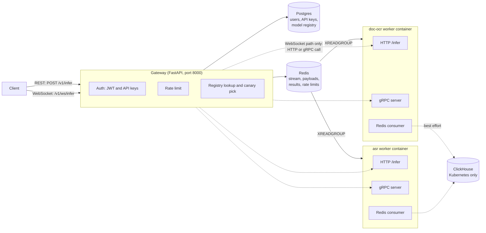
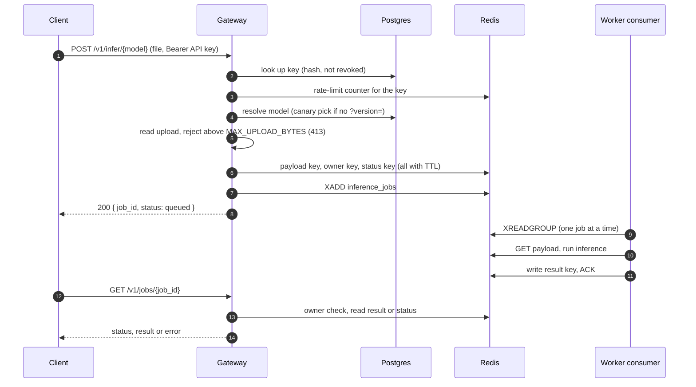
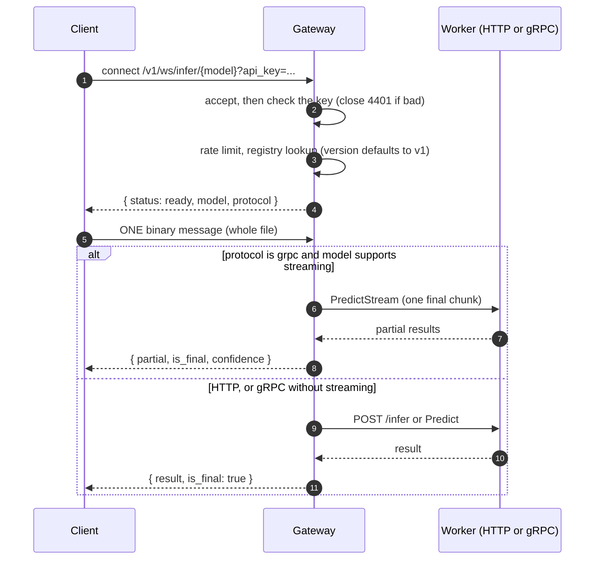
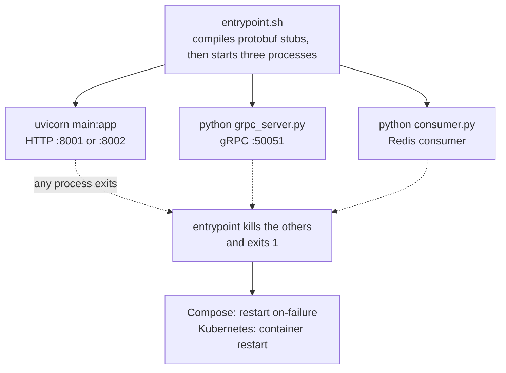

# Architecture

How ModelMesh is put together and why. Queue and worker internals are in [Queue and workers](queue-and-workers.md); the model registry and canary logic are in [Registry and canary](registry-and-canary.md); storage is in [Data stores](data-stores.md).

## What it is

A FastAPI gateway in front of model workers. Clients authenticate, pick a model **by name**, and either submit an asynchronous job (REST) or stream a request over a WebSocket. The gateway looks the model up in a Postgres **registry** at request time, so adding, disabling or re-pointing a model is a data change, not a code change.

Two example workers ship with it: `doc-ocr` (EasyOCR) and `asr` (Whisper `tiny`). Everything else (auth, rate limiting, queueing, canary routing, metrics) is generic and does not know which models exist.

The design goals visible in the code:

1. **Registry-driven routing.** Model name, version, protocol, endpoint, status and canary percentage live in Postgres.
2. **Asynchronous by default.** REST inference returns a job ID immediately and a worker picks the job up from a Redis stream.
3. **Never lose a job silently where avoidable.** Retries with backoff, a dead-letter stream, and recovery of jobs left behind by a crashed worker.
4. **Observability must not break inference.** Metric writes are best-effort and back off after a failure.
5. **Honest scope.** Features that are not built (Prometheus, Grafana, TLS, Ingress, autoscaling) are documented as absent, not implied.

## System overview

Solid lines are the REST job path. Dotted lines are the WebSocket path (the gateway calls the worker directly) and the optional metrics write.

## Components

| Component    | Where                                                   | Responsibility                                                                                           |
| ------------ | ------------------------------------------------------- | -------------------------------------------------------------------------------------------------------- |
| Gateway      | `gateway/main.py` and helpers                           | HTTP and WebSocket API, auth, rate limiting, registry reads and writes, job enqueue, job status          |
| Registry     | `gateway/registry.py`, Postgres `models` table          | Model records: name, version, worker name, protocol, endpoint, status, streaming support, canary percent |
| Job queue    | `gateway/job_queue.py`, Redis                           | Stores the payload, owner and status, and appends a job to the shared stream `inference_jobs`            |
| Workers      | `workers/doc_ocr/`, `workers/asr/`                      | Each container runs three processes: an HTTP server, a gRPC server and a Redis consumer                  |
| Canary guard | `gateway/canary_guard.py`                               | Optional CLI that reads ClickHouse metrics and can reset `canary_percent` to 0                           |
| Kafka code   | `gateway/kafka_queue.py`, `workers/*/kafka_consumer.py` | **Dormant.** Not imported, not deployed, and it has diverged from the Redis path                         |

## Request path 1: asynchronous job (REST)

Details that matter:

- The **worker is chosen from the registry's `worker_name`**. The REST path does not read the registry's `protocol` or `endpoint`; the workers pull from Redis.
- The upload size limit is checked **after** FastAPI has parsed the multipart body. There is no HTTP-level body limit in the code.
- A job belongs to the **user** who created it. Other users get `404`, the same as for an unknown or expired job.

## Request path 2: WebSocket (direct)

How it differs from the REST path:

|                                         | REST job                             | WebSocket                                                     |
| --------------------------------------- | ------------------------------------ | ------------------------------------------------------------- |
| Result                                  | Poll `GET /v1/jobs/{id}`             | Returned on the same socket                                   |
| Worker call                             | Redis stream, consumed by the worker | Gateway calls the worker's HTTP or gRPC endpoint **directly** |
| Uses registry `protocol` and `endpoint` | No (uses `worker_name`)              | Yes                                                           |
| Canary routing                          | Yes, when no `?version=`             | **No.** Defaults to `v1` unless a version is given            |
| Retries, DLQ, metrics                   | Yes                                  | **None**                                                      |
| Auth                                    | `Authorization: Bearer`              | `?api_key=` query parameter                                   |
| Input                                   | One multipart file                   | One binary message, whole file                                |

"Streaming" is narrower than the name suggests: the client sends the **entire file as one message**, and the ASR gRPC stream receives exactly one final chunk. See [Queue and workers](queue-and-workers.md#grpc-servers).

## Worker container process model

Consequences:

- **Each process loads its own copy of the model.** The ASR image loads Whisper in all three; the OCR image creates an EasyOCR reader at import in all three. Memory is therefore roughly three times a single model instance (see measured figures in [Operations](operations.md#resource-sizing)).
- **A dead sub-process takes the container down**, so a half-working worker restarts instead of lingering.
- Each consumer handles **one job at a time**. Throughput scales with the number of replicas, not with threads.
- The container runs as root; there is no `USER` instruction in any Dockerfile.

## Deployment shapes

|                                           | Docker Compose                                                              | Kubernetes (minikube-oriented)                                                                                      |
| ----------------------------------------- | --------------------------------------------------------------------------- | ------------------------------------------------------------------------------------------------------------------- |
| Services                                  | gateway, doc-ocr, asr, Postgres 16, Redis 7                                 | The same, plus ClickHouse; namespace `modelmesh`                                                                    |
| Metrics                                   | Off (ClickHouse is not in Compose)                                          | On, once the table DDL is applied by hand                                                                           |
| Postgres                                  | Named volume; `init.sql` runs only on a **fresh** volume                    | StatefulSet with a 1 Gi PVC; `init.sql` from a ConfigMap                                                            |
| Redis                                     | Volume `redisdata`                                                          | **Deployment with no volume**: queue, results and payloads are lost on pod restart. `maxmemory 200mb`, `noeviction` |
| Secrets                                   | Plain values in the Compose file; `JWT_SECRET` from `.env` or a placeholder | Dev Secret manifests committed to the repo (not for production)                                                     |
| Ingress, TLS, autoscaling, network policy | None                                                                        | None                                                                                                                |

Kubernetes manifests: 14 objects (namespace, 6 Services, 5 Deployments, 1 StatefulSet, 1 ConfigMap) plus two Secret manifests that were not part of the reviewed export.

## Decisions and trade-offs

**One shared stream, one consumer group per worker.** All models write to `inference_jobs`; each worker's group reads every entry and acknowledges-and-skips entries meant for a different `worker_name`. This makes adding a worker a data change, at the cost that every worker reads every job. It also drove two rules: `XDEL` after `XACK` is **not** used (another group may not have read the entry), and `MAXLEN` trimming can drop unread entries if a backlog ever exceeds the limit.

**Payload outside the stream.** The uploaded bytes sit under `payload:{job_id}` with a TTL, not in the stream entry, so retries and the DLQ do not copy the file. The price is that payloads stay in Redis until they expire, even after a job succeeds.

**Registry-driven canary, not replica ratios.** The split is a probability applied per request in the gateway. It works with any orchestrator, but it only governs the REST path.

**Best-effort metrics.** One insert attempt per job on its **final** outcome; after a failure each worker skips attempts for 60 seconds. Observability outages never fail a job, but rows can be lost.

**Process isolation inside one container.** HTTP, gRPC and consumer are separate processes so one failure is visible to the supervisor, at the cost of three model copies.

**A new gRPC channel per call.** Deliberately not pooled, so calls spread across worker replicas behind a Kubernetes Service.

**Scope kept small.** Prometheus, Grafana, a result cache, a Postgres request log and a sliding-window rate limiter were documented in early drafts but never built; the decision was to correct the documents, not build them.

## Code map

| Path                                                                                   | What is there                                                         |
| -------------------------------------------------------------------------------------- | --------------------------------------------------------------------- |
| `gateway/main.py`                                                                      | All HTTP and WebSocket routes, canary pick, `route_request`           |
| `gateway/auth.py`, `rate_limit.py`, `schemas.py`, `db.py`                              | Auth, limiter, request models, connections                            |
| `gateway/registry.py`, `job_queue.py`, `grpc_client.py`                                | Registry SQL, Redis enqueue and job status, gRPC calls                |
| `gateway/canary_guard.py`                                                              | Standalone guard CLI and its pure `decide()` function                 |
| `workers/<name>/main.py, grpc_server.py, consumer.py, inference.py, metrics.py`        | The three processes, the model, the metric writer                     |
| `db/init.sql`, `migrations/`, `clickhouse/init.sql`                                    | Schemas and idempotent migrations                                     |
| `docker-compose.yml`, `docker-compose.test.yml`, `k8s/`                                | Deployment definitions                                                |
| `scripts/smoke_test.sh`, `test_ws_client.py`, `ws_latency_compare.py`, `load-test.yml` | Smoke test, WebSocket client, latency comparison, Artillery load test |
| `tests/`                                                                               | 102 pytest tests; see [Testing](testing.md)                           |

Size: about 4,400 lines of Python (gateway 1,242, workers 1,119, tests 1,768).

## Things to know before changing code

- The two worker `consumer.py` files are near-identical copies (about 240 lines each). Change both.
- The two worker `metrics.py` files are identical.
- `gateway/main.py` and `canary_guard.py` each contain their own copy of the "highest numeric version" rule.
- `inference.proto` is the contract between gateway and workers. It was **not in the reviewed export**; the gRPC messages documented here were inferred from the code.
- Several files assume the generated protobuf modules exist: the gateway Dockerfile compiles them at **build** time, the worker entrypoints at **container start**.
