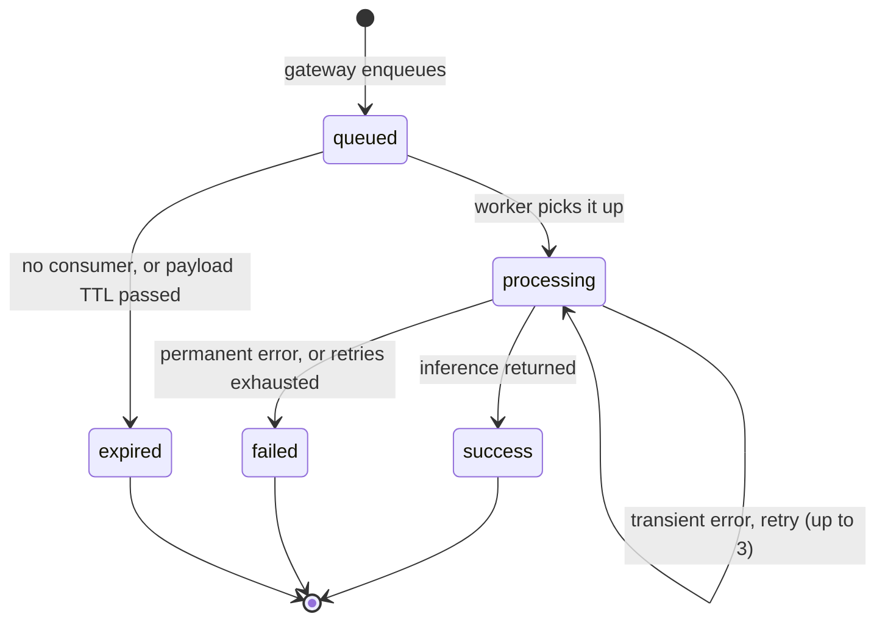
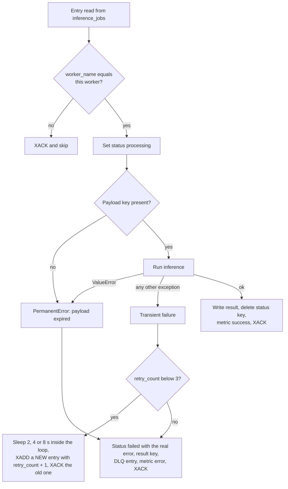

# Queue and workers

How a REST job travels from the gateway to a worker and back, what happens when something fails, and what each worker actually does. Storage details (key names, TTLs) are in [Data stores](data-stores.md).

## Job lifecycle



| Status       | Visible to the client as                                  | Notes                                                               |
| ------------ | --------------------------------------------------------- | ------------------------------------------------------------------- |
| `queued`     | `{ job_id, status: "queued", model_name, model_version }` | Written by the gateway                                              |
| `processing` | `status: "processing"`                                    | Stays `processing` during retries; it is never set back to `queued` |
| `success`    | `{ job_id, status: "success", result: { … } }`            | Result lives 2 hours                                                |
| `failed`     | `{ job_id, status: "failed", error: "<real message>" }`   | The error is the actual exception text, not a generic message       |
| expired      | HTTP `404 Job not found or expired`                       | Also returned for a job that belongs to another user                |

Real result shapes (captured by running the consumer logic against Redis with stubbed inference):

```json
{ "job_id": "344b70d6-…", "status": "success", "result": { "text": "hi", "avg_confidence": 0.93, "line_count": 1 } }
{ "job_id": "6857a33c-…", "status": "failed",  "error": "Invalid image data" }
```

## Consumer algorithm

Each worker container runs one consumer process. It reads **one entry at a time** (`XREADGROUP … COUNT 1 BLOCK 5000`) from the shared stream `inference_jobs`, using the consumer group `{WORKER_NAME}_group` and the consumer name `{WORKER_NAME}-{HOSTNAME}`.



### Failure handling

| Case                                                                          | What happens                                                                                                                                                                | Verified                                            |
| ----------------------------------------------------------------------------- | --------------------------------------------------------------------------------------------------------------------------------------------------------------------------- | --------------------------------------------------- |
| Entry for another worker                                                      | Acknowledged and skipped. **Every** worker's group sees every entry                                                                                                         | Code                                                |
| Invalid input (`ValueError` from inference, for example "Invalid image data") | **Permanent**: no retry; status `failed` with that message; one DLQ entry; one `error` metric                                                                               | Run: 1 attempt, no sleeps, 1 DLQ entry              |
| Payload key missing (expired)                                                 | Permanent: `payload expired`                                                                                                                                                | Code                                                |
| Any other exception                                                           | **Transient**: up to 3 retries with sleeps of 2, 4 and 8 s, so **4 attempts** in total                                                                                      | Run: 4 attempts, sleeps `[2, 4, 8]`                 |
| Retries exhausted                                                             | Status `failed` with the real last error; one DLQ entry; **one** `error` metric (retries write none)                                                                        | Run                                                 |
| Worker crashes mid-job                                                        | The entry stays pending; after `RECLAIM_IDLE_MS` (default 300,000 ms) any consumer in the group reclaims it with `XAUTOCLAIM` and reprocesses it                            | Test with a real Redis; recorded live on Kubernetes |
| Crash after writing the result but before `XACK`                              | Redelivered later and processed again (at-least-once): the result is overwritten, a duplicate metric row is possible                                                        | Reasoning from the code                             |
| An entry that crashes the worker every time                                   | Reclaimed again and again; there is no delivery-count limit                                                                                                                 | Documented limitation                               |
| Job enqueued, then the model is disabled                                      | Still processed. The consumer never consults the registry                                                                                                                   | Documented in Phase 2                               |
| Registered `worker_name` has **no worker running**                            | The job is acknowledged-and-skipped by every other group and **never processed**. No error, no DLQ entry; the client sees `queued` until the status key expires, then `404` | Derived from the code and the recorded canary demo  |
| Redis unavailable                                                             | Consumer logs the error, sleeps 1 s and retries the loop; the gateway returns 500 for enqueue                                                                               | Code                                                |

A retry adds a **new** stream entry and acknowledges the old one. One job that fails after all retries therefore leaves four entries in the stream (all acknowledged).

### Head-of-line blocking

The backoff `sleep` runs **inside the consumer loop**, which handles one entry at a time. A job that fails transiently blocks its consumer for up to 2 + 4 + 8 = **14 seconds** of sleeping before the final failure, and other jobs wait. Scale replicas, not threads.

### Maintenance

At most every 30 seconds (checked after each read, which returns within 5 s) the consumer:

1. logs `Stream length: N, Pending: M` and warns if the stream is above 80% of `STREAM_MAXLEN`;
2. reclaims stale pending entries with `XAUTOCLAIM` (batches of 10, up to 100 batches, so at most 1,000 entries per pass).

Reclaim also runs once at start-up. `RECLAIM_IDLE_MS` must exceed your slowest job plus the 14 s of backoff, or a healthy job can be reclaimed while it is still running.

## The workers

Both workers expose the same three interfaces and share the same consumer and metrics code. They differ only in the model.

|                                 | `doc-ocr`                                                                           | `asr`                                                                                    |
| ------------------------------- | ----------------------------------------------------------------------------------- | ---------------------------------------------------------------------------------------- |
| Model                           | EasyOCR, English only, CPU                                                          | OpenAI Whisper `tiny` (`WHISPER_MODEL`), CPU                                             |
| Input                           | Image bytes (decoded with OpenCV)                                                   | Audio bytes (decoded by `ffmpeg` through Whisper)                                        |
| Result                          | `{ "text": "<lines joined by \n>", "avg_confidence": 0.0 to 1.0, "line_count": n }` | `{ "text": "…" }` only (no confidence, segments or language)                             |
| Invalid input                   | `ValueError("Invalid image data")`                                                  | `RuntimeError` "Failed to load audio" is converted to `ValueError("Invalid audio data")` |
| HTTP port                       | 8001                                                                                | 8002                                                                                     |
| gRPC                            | `Predict` only                                                                      | `Predict` and `PredictStream`                                                            |
| Registry seed                   | `supports_streaming = false`                                                        | `supports_streaming = true`                                                              |
| Model loading                   | At **import** of `inference.py`                                                     | Lazily, under a lock, preloaded at start-up                                              |
| Reported memory (idle, Compose) | 1.185 GiB                                                                           | 1.084 GiB                                                                                |

Neither worker limits image dimensions or audio duration; only the byte cap applies. A small compressed upload can still decode to something large.

### HTTP interface

`POST /infer` with a multipart `file`. It reads the whole file and returns JSON; invalid input is `400`. The ASR worker also checks the content type against an allow-list (audio types and `application/octet-stream`, which is what the gateway sends). `GET /health` always returns `{"status": "ok"}`: it does not check the model, Redis or ClickHouse.

The workers do not enforce a size limit; the gateway does.

### gRPC servers

The service is `InferenceWorker`. The `.proto` file was not in the reviewed export, so this is the contract **inferred from how the code uses it**:

| RPC                                       | Request                                                                    | Response                                                                                |
| ----------------------------------------- | -------------------------------------------------------------------------- | --------------------------------------------------------------------------------------- |
| `Predict` (unary)                         | `InferenceRequest { payload: bytes, model_name: string }`                  | `InferenceResponse { result_json: string, latency_ms: float }`                          |
| `PredictStream` (bidirectional, ASR only) | stream of `InferenceChunk { chunk: bytes, sequence: int, is_final: bool }` | stream of `InferenceResult { partial_text: string, is_final: bool, confidence: float }` |

Behaviour to be aware of:

- **`PredictStream` transcribes each chunk independently** as a complete audio file. It is not incremental transcription. The gateway sends exactly **one** final chunk, so in practice it is whole-file transcription.
- **`confidence` is always `0.0`**, because `transcribe()` returns only text.
- A per-chunk failure is returned as a normal result whose `partial_text` is `[Error: <message>]`, indistinguishable from a transcript except by that prefix.
- `Predict` reports failures with gRPC status `INTERNAL` and the raw exception text in the details.
- The OCR worker has no `PredictStream`; calling it returns `UNIMPLEMENTED`.
- Insecure channels, no TLS. The gateway opens a **new channel per call** (30 s timeout for `Predict`, 60 s for `PredictStream`). Message limit is `MAX_UPLOAD_BYTES + 1 MiB` on both sides.
- Server threads: `GRPC_MAX_WORKERS` (10 locally, 3 in the Kubernetes manifests). Concurrent calls share one model instance without a lock around inference.

### Supervision

`entrypoint.sh` compiles the protobuf stubs, then starts the HTTP server, the gRPC server and the consumer in the background. If **any** exits, it stops the others and exits with code 1, so the container restarts (`restart: on-failure` in Compose; the Kubernetes container restart policy). On `SIGTERM` or `SIGINT` it stops the children and exits 0. Kubernetes also probes `/health` on each worker.

## Throughput and scaling

- One consumer process handles one job at a time; replicas of the same worker share the consumer group, so each entry goes to one of them.
- `kubectl scale deployment doc-ocr-worker --replicas=3` is the documented way to add capacity. Each replica loads its own three model copies.
- Compose runs one container per worker.
- No autoscaling exists.

## Metrics

Each worker writes one ClickHouse row per finished job when `CLICKHOUSE_HOST` is set. See [Data stores](data-stores.md#clickhouse).

## Kafka (dormant)

`gateway/kafka_queue.py` and `workers/*/kafka_consumer.py` are not imported anywhere and not deployed. They have drifted from the Redis path: no retries, no dead-letter queue, no permanent/transient split, no reclaim, no metrics, no owner key, and a different enqueue signature. The worker's Kafka module hard-codes its worker name. They are kept and labelled dormant, not maintained. `aiokafka` is still installed in the gateway and worker images.
