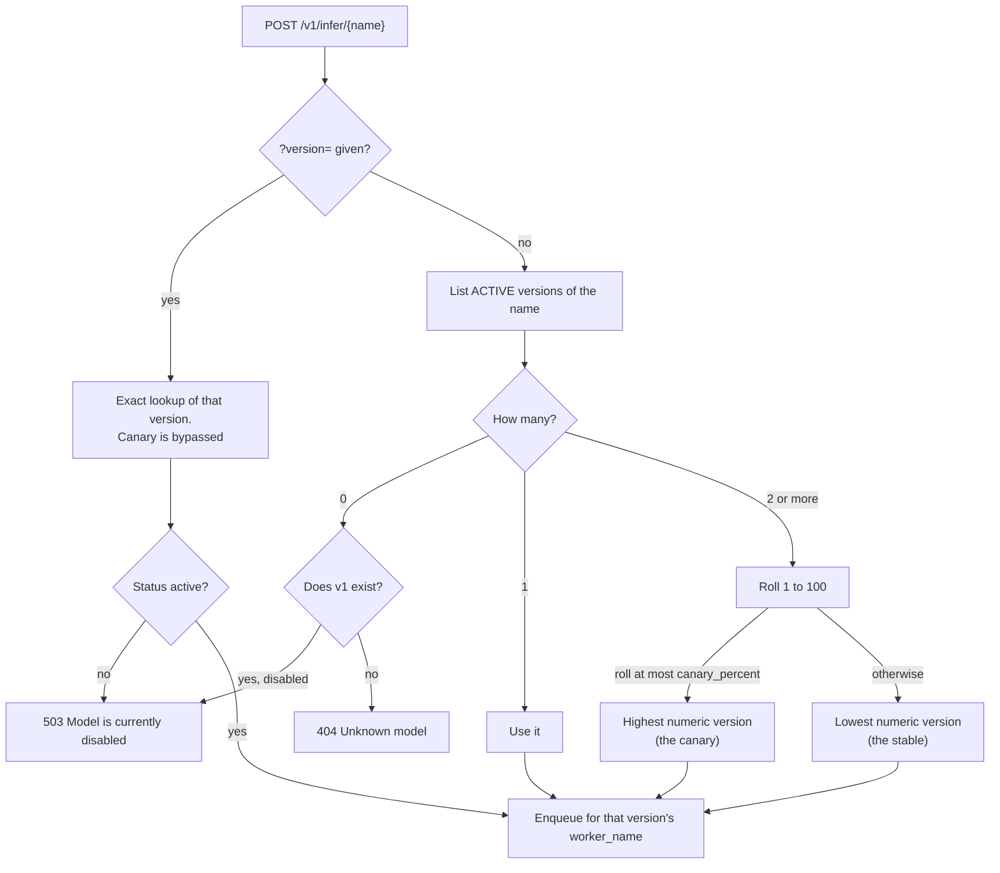
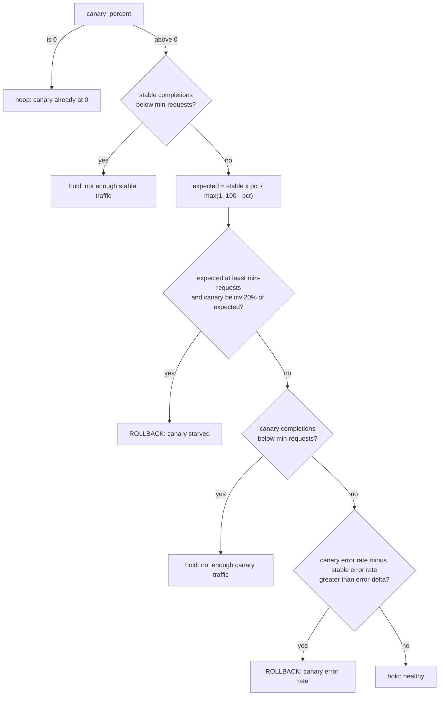

# Registry and canary

How models are registered and chosen, how a canary split works, how to run one, and what the optional rollback guard does. Endpoint details are in [API](api.md).

## The model registry

Every model version is one row in the Postgres `models` table (see [Data stores](data-stores.md#postgres)).

| Field                  | Meaning                                                                        |
| ---------------------- | ------------------------------------------------------------------------------ |
| `name`                 | What clients ask for (`/v1/infer/{name}`)                                      |
| `version`              | `v<number>`. New registrations must match `^v\d+$`                             |
| `worker_name`          | Which worker consumer group handles **REST jobs** for this version             |
| `protocol`, `endpoint` | How the gateway calls the worker directly. **Used only by the WebSocket path** |
| `status`               | `active` or `disabled` (`deleted` exists in the schema but nothing sets it)    |
| `supports_streaming`   | With `protocol = grpc`, the WebSocket path uses `PredictStream`                |
| `canary_percent`       | 0 to 100; meaningful on the **highest** active version                         |

Registering a model records metadata only. **It does not deploy anything.** A worker that consumes `worker_name` must already be running, or REST jobs for that model are never processed (see [failure handling](queue-and-workers.md#failure-handling)).

Registry changes take effect on the next request. The gateway reads Postgres on every call and keeps no cache.

## How a model version is chosen (REST)



Rules, all checked by running the gateway against a real database:

- **Highest and lowest are numeric.** `v10` outranks `v9`. With versions `v1`, `v2`, `v9`, `v10` and 30% on the highest, 400 unpinned requests went 275 to `v1` and 125 to `v10`; `v2` and `v9` received **nothing**. Versions in between never get traffic.
- **The percentage is read from the canary row** (the highest version). Setting `canary_percent` on the stable row has no effect.
- **The split is probabilistic.** A 50% split over 20 requests produced 10 and 10 in one recorded run; do not rely on exact ratios for small samples.
- **A single active version is used as-is.** A model with only `v2` active routes to `v2`.
- **Pinning with `?version=` bypasses the canary** and returns `404` for an unknown version or `503` for a disabled one.
- **Quirk:** when no version is active, the gateway checks only for `v1` to decide between 503 and 404. A model whose **only** version is a disabled `v2` returns `404 Unknown model`, not `503`.
- `GET /v1/models/{name}` also defaults to `v1`, so a model with only `v2` needs `?version=v2`.

The WebSocket path does **not** use this logic. It defaults to `v1` unless `?version=` is given, and never applies a canary.

## Switching a model's protocol (WebSocket path only)

The WebSocket path calls the worker at `endpoint` over `protocol`. Changing them is a registry update:

```bash
curl -X PATCH http://localhost:8000/v1/models/$MODEL_ID \
  -H "Authorization: Bearer $ADMIN_KEY" -H 'Content-Type: application/json' \
  -d '{"protocol": "grpc", "endpoint": "doc-ocr-worker:50051"}'
```

HTTP endpoints are full URLs (`http://doc-ocr-worker:8001/infer`); gRPC endpoints are `host:port` with no scheme. This has **no effect on REST jobs**, which always use `worker_name` and the Redis queue.

Recorded comparison (Phase 3, 20 sequential WebSocket requests per protocol; reproducible with `ws_latency_compare.py`): gRPC was about 6% faster at the median for OCR (369.9 ms vs 394.2 ms) and about 3% for ASR (739.5 ms vs 760.4 ms). Inference time dominates; the value of gRPC here is a typed contract, not speed. The script switches the model to gRPC and **does not restore it**, so check the registry afterwards.

## Adding a model or a version

1. **Build a worker** that follows the same contract as the two existing ones: an HTTP `POST /infer` (for WebSocket calls), optionally a gRPC `Predict`, and a consumer. The simplest path is to copy an existing worker directory, change `inference.py`, and set a unique `WORKER_NAME`. The consumer must read `payload:{job_id}` and write `result:{job_id}` in the formats described in [Data stores](data-stores.md#redis).
2. **Deploy it** (Compose service or Kubernetes Deployment + Service).
3. **Register it** with an admin key:

   ```bash
   curl -X POST http://localhost:8000/v1/models \
     -H "Authorization: Bearer $ADMIN_KEY" -H 'Content-Type: application/json' \
     -d '{"name":"doc-ocr","version":"v2","worker_name":"doc-ocr-worker-v2",
          "protocol":"http","endpoint":"http://doc-ocr-worker-v2:8001/infer",
          "canary_percent":0,"description":"candidate"}'
   ```

   Response: `{ "id": "<uuid>", "status": "registered" }`. A duplicate name and version returns `409`.

4. **Send traffic.** Start at `canary_percent` 0 and test with `?version=v2`; raise the percentage when ready.

Notes: a brand-new name (not a new version) works the same way, with `v1`. Updating a row cannot change its `name` or `version`, and it cannot clear `description` once set.

## Running a canary

| Step      | Action                                                                                                            |
| --------- | ----------------------------------------------------------------------------------------------------------------- |
| Register  | Add `v2` with a `worker_name` that has a running worker                                                           |
| Start     | `PATCH` `canary_percent` to a small number, for example 10                                                        |
| Watch     | Query ClickHouse for error rate and latency by `model_version` (see [Data stores](data-stores.md#useful-queries)) |
| Promote   | `PATCH` `canary_percent` to 100, then disable `v1`                                                                |
| Roll back | `PATCH` `canary_percent` to **0**. Do **not** disable `v2` as part of a rollback                                  |

Metrics come only from the Redis workers and require ClickHouse (Kubernetes, with the DDL applied). With no ClickHouse, you can still split traffic but you cannot measure the result.

Two limits to remember:

- Jobs already assigned to a canary whose worker is down or gone stay unprocessed until their keys expire; clients polling them eventually get `404`.
- Pinned requests and WebSocket traffic are not part of the split. Pinned requests are counted in the metrics under the version they asked for.

The recorded canary verification used `v1` and `v2` pointed at the **same** worker. It proves the routing mechanism, not a real rollout.

## The rollback guard

`gateway/canary_guard.py` is an optional, standalone CLI. It is not part of request handling and is not scheduled anywhere (the optional Kubernetes CronJob was skipped).

For every model with two or more active versions and `canary_percent > 0`, it compares the lowest (stable) and highest (canary) versions over a look-back window using ClickHouse final-outcome rows, and decides.



**Why a starvation rule exists.** The queue is asynchronous. If the canary's worker is down, its jobs are never processed and **produce no errors**, so an error-rate rule alone would never fire. The starvation rule notices that the canary completes far fewer jobs than its share implies.

### Usage

```bash
# Dry run (the default): prints decisions, changes nothing
CLICKHOUSE_HOST=localhost GATEWAY_URL=http://localhost:8000 python gateway/canary_guard.py

# Act: PATCHes canary_percent to 0 on a rollback decision, nothing else
ADMIN_KEY=... python gateway/canary_guard.py --apply
```

| Option or variable                    | Default                 | Meaning                                                     |
| ------------------------------------- | ----------------------- | ----------------------------------------------------------- |
| `--window-min`                        | 10                      | Look-back window in minutes                                 |
| `--min-requests`                      | 30                      | Minimum completions per version for the data to count       |
| `--error-delta`                       | 0.10                    | Error-rate margin the canary may exceed stable by           |
| `--apply`                             | off                     | Perform rollbacks. Requires `ADMIN_KEY` in the environment  |
| `GATEWAY_URL`                         | `http://localhost:8000` | Where to read models and send the `PATCH`                   |
| `CLICKHOUSE_HOST` / `CLICKHOUSE_PORT` | `clickhouse` / 8123     | Metrics store (the default host name is the Kubernetes one) |

Pass the admin key by environment only, never on the command line. It prints one JSON line per model pair (time, model, versions, percent, per-version counts and error rates, decision, reason, `applied`) and exits 0 unless the guard itself fails. It reads `GET /v1/models` without authentication.

### What the decision function does (verified by running it)

With the default settings:

| Situation                                                                                | Decision                                                          |
| ---------------------------------------------------------------------------------------- | ----------------------------------------------------------------- |
| Healthy canary **just enabled** at 20%; stable has 200 completions; canary has 0, 3 or 9 | **rollback** ("canary starved: N completed vs about 50 expected") |
| Same, canary has 10 or 20                                                                | hold ("not enough canary traffic")                                |
| Same, canary has 50                                                                      | hold ("healthy")                                                  |
| Stable has 29 completions                                                                | hold ("not enough stable traffic")                                |
| Canary error rate 0.30, stable 0.00, enough traffic                                      | rollback                                                          |
| Canary error rate exactly 0.10 above stable                                              | hold; 0.11 above → rollback                                       |
| `canary_percent` 0                                                                       | noop                                                              |

The starvation rule can only fire when `expected` reaches `--min-requests`. At the default minimum of 30, stable needs this many completions in the window:

| `canary_percent` | Stable completions needed |
| ---------------- | ------------------------: |
| 5                |                       570 |
| 10               |                       270 |
| 20               |                       120 |
| 50               |                        30 |

So with stable 73 and canary 0 at 20%, the default settings return **hold**, not rollback. The recorded live demo (90 ASR jobs, a rollback with "0 completed vs about 18 expected") must have used a lowered `--min-requests`, as the Phase 11 plan specifies (`--min-requests 10`).

### Limitations

- **No memory of when the canary started.** The window is a plain look-back, so right after enabling or raising a canary the guard can roll back a healthy canary (the 0, 3, 9 rows above). **Operating rule: after enabling or raising a canary, wait one full window before running with `--apply`, and never schedule `--apply` more often than the window.**
- **100% edge case.** At `canary_percent = 100` the formula divides by `max(1, 0) = 1`, so "expected" is the stable completions times 100. With stable at 100 completions still inside the window and a canary that completed 500, the function returns rollback ("500 completed vs about 10000 expected"); it holds only if the canary completed 2,000 or more. Once stable traffic has aged out of the window (fewer than 30 completions) it holds. Wait a window after promoting.
- **Pinned traffic distorts the starvation estimate.** The formula assumes every request was routed by the canary split, but pinned requests are counted under their version.
- **Metrics are final outcomes from the Redis workers only.** WebSocket traffic is invisible to it.
- **Rollback only sets `canary_percent` to 0.** It never disables, promotes or deploys anything, and it has no notifications, statistical testing or latency rule.
- The version ordering rule is duplicated from the gateway.
- Thin traffic means the guard holds; it never rolls back on too little data.
