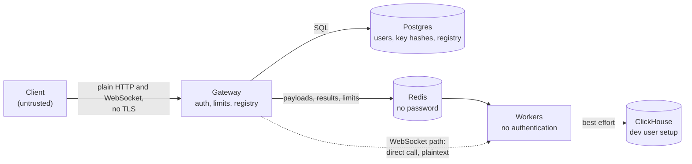

# Security

What protects the system today, what does not, and what an operator must add before exposing it. This is a source review plus runtime checks against a real gateway, Postgres and Redis. It is **not** a penetration test, and nothing here has had external review. The project's own README says it is a development implementation and not production-ready; this document agrees and explains why.

## What is being protected

Users upload **documents and audio**, which may be sensitive, and get extracted text back. The system also holds credentials (password hashes, API-key hashes, a JWT signing secret) and an internal network of unauthenticated workers.

Everything to the right of the gateway trusts the network it sits on. There is no authentication, encryption or network policy between internal components.

## Controls that exist

| Area                 | Control                                                                                                                                        | Where                     |
| -------------------- | ---------------------------------------------------------------------------------------------------------------------------------------------- | ------------------------- |
| Passwords            | bcrypt hashing; at least 8 characters for new accounts                                                                                         | `auth.py`, `schemas.py`   |
| API keys             | 256-bit random keys; only a SHA-256 hash is stored; a revoked flag is honoured on lookup                                                       | `auth.py`                 |
| Admin                | Registry writes need `is_admin`; admin cannot be granted through the API                                                                       | `auth.py`                 |
| Job privacy          | A job is visible only to the user who created it; a foreign job returns the same `404` as a missing one                                        | `job_queue.py` (verified) |
| Rate limiting        | Atomic per-key counter in Redis                                                                                                                | `rate_limit.py`           |
| Upload size          | One cap (default 10 MiB) on REST and both WebSocket paths; also `--ws-max-size` on the server                                                  | `main.py`, Dockerfile     |
| Registry input       | `version` pattern, `protocol` and `status` literals, `canary_percent` range, enforced by Pydantic and by database CHECK constraints            | `schemas.py`, `init.sql`  |
| SQL                  | Named parameters throughout; the one dynamic `UPDATE` builds its column list from a fixed allow-list                                           | `registry.py`             |
| Public model listing | `endpoint` and `worker_name` are not returned                                                                                                  | `main.py` (verified)      |
| Logging              | `api_key=` query values are redacted in the server's access and error logs                                                                     | `main.py`                 |
| Secrets in config    | Database URL and JWT secret come from environment or Kubernetes Secrets; a warning is logged if the JWT secret is the placeholder              | `auth.py`, manifests      |
| Network exposure     | Compose does not publish Postgres or Redis (only the test override does); Kubernetes uses ClusterIP for everything except the gateway NodePort | Compose, `k8s/`           |
| Revoked keys         | Rejected on the WebSocket path too (it shares the same lookup)                                                                                 | `main.py`                 |

## Gaps

Every item was confirmed by reading the code; those marked **verified** were also reproduced.

### Transport and exposure

- **No TLS anywhere**, including gRPC, which uses insecure channels. Credentials, uploads and results cross the network in clear text. No Ingress or TLS termination exists in the manifests.
- **Worker endpoints have no authentication.** In Compose, ports 8001, 8002, 50051 and 50052 are **published to the host**, so anyone who can reach the host can call a worker and bypass the gateway's auth and rate limit. In Kubernetes they are cluster-internal.
- **Redis has no password**, and the Kubernetes Redis has no NetworkPolicy in front of it. Anything that can reach it can read uploaded payloads and results.
- `/docs`, `/redoc` and `/openapi.json` are served without authentication (**verified**). The app sets no security headers and no CORS policy.

### Authentication and abuse

- **Open registration.** Anyone can create an account and API keys. Registration and login are **not rate limited**; login runs bcrypt on every attempt, so it is both brute-forceable and a CPU lever.
- **The per-key limit is not a per-user limit.** A user chooses `rate_limit_per_min` (1 to 1000) for each key and can create unlimited keys.
- **No key management.** No endpoint lists or revokes keys, and none creates admin keys; both are done in SQL. The `revoked` column is read but never written by the application.
- **A placeholder JWT secret is allowed.** If `JWT_SECRET` is unset, the code logs a warning and runs; the Compose file substitutes `change-me-in-production`. A forged JWT can create API keys for any user ID.
- **API keys travel in the WebSocket URL** (`?api_key=`). The gateway redacts its own logs; reverse proxies and browser history may not.
- **The WebSocket is accepted before authentication.** Unauthenticated clients can hold a connection open briefly before being closed with 4401.
- An admin can set a model's `endpoint` to **any string**. The gateway will POST user uploads to it on the WebSocket path. Admin keys are therefore powerful; treat them like root credentials. (The Phase 11 report records a local admin credential that was accidentally exposed and rotated; the guard script takes the admin key from the environment, not the command line, for this reason.)

### Information disclosure

- **WebSocket errors return raw exception text** (**verified**). When a worker responds with an HTTP error, the client receives a message containing the worker's internal URL, which `/v1/models` is built to hide. gRPC failures return the worker's exception text in the status details.
- **`GET /v1/models` is public** and shows model IDs, versions, status and `canary_percent`.
- Worker `/health` is unauthenticated and uninformative by design.

### Data handling

- **Uploads are retained after processing.** The payload stays in Redis for an hour even after the job succeeds (**verified**); results and ownership for two hours; both are lost on a Redis restart in Kubernetes. There is no per-job delete endpoint and no encryption at rest.
- Results contain the extracted text or transcript, which may be personal data.
- The size cap on REST is checked **after** the body is parsed; there is no HTTP-level body limit in the application. Put a limit in front of it.
- Memory exhaustion: with the Kubernetes Redis limit (200 MB, no eviction), a single client sending maximum-size uploads makes the **16th request fail with HTTP 500** (**verified**), and `/ready` keeps returning 200. See [Data stores](data-stores.md).
- Neither worker limits image dimensions or audio duration, and both decode untrusted input (OpenCV, EasyOCR, `ffmpeg` through Whisper) as root.

### Deployment hygiene

- **Development secrets are committed or inline**: a plaintext Postgres password in Compose, two Kubernetes Secret manifests with placeholder values (not in the reviewed export, described in the setup docs). Replace them.
- **All containers run as root**; no `securityContext`, `runAsNonRoot`, read-only filesystem, resource quotas beyond requests and limits, or NetworkPolicies.
- ClickHouse runs with `CLICKHOUSE_SKIP_USER_SETUP=1` in development (no default-user password).
- No dependency or image scanning, and no CI pipeline.
- A model-registry write by anyone with an admin key takes effect on the next request with no audit trail.

## What an operator must add before real use

1. **TLS** in front of the gateway (Ingress or a reverse proxy), and an internal mesh or at least a NetworkPolicy so only the gateway reaches workers, Redis and Postgres.
2. A **real `JWT_SECRET`** (and make the gateway refuse to start without it).
3. **Registration control** (disable, invite-only, or rate limited) and a **per-user** request cap.
4. A **request body size limit** at the edge.
5. A **Redis password**, persistence and a memory policy that fails gracefully; alert on memory use because `/ready` will not.
6. **Replace development secrets**; do not use the committed values.
7. Do not publish worker ports; remove the host mappings in Compose or bind them to localhost.
8. Decide **retention**: how long uploads and results may remain, and how to delete them.
9. Remove or protect `/docs` and `/openapi.json`; stop returning raw exception text over the WebSocket.
10. Run containers as a non-root user and add resource and image scanning to a pipeline.

## What was verified for this document

Against a real Postgres 16 and Redis 7:

- Foreign users cannot read a job (404); the owner can.
- `/v1/models` entries contain no `endpoint` or `worker_name`.
- The WebSocket error path returns the internal worker URL.
- A finished job's payload remains in Redis (TTL 3600).
- A full Redis causes a 500 on upload while `/ready` stays 200.
- `/docs`, `/redoc`, `/openapi.json` return 200; `/metrics` returns 404; a CORS preflight returns 405 and no security headers are present.
- No code writes the `requests` table or sets `revoked`.

Not verified: TLS behaviour (none), Kubernetes network behaviour, container hardening, dependency vulnerabilities (no scan was run), and the behaviour of the real EasyOCR and Whisper models on hostile input.
